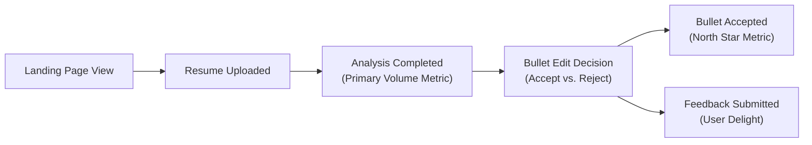

# Product Requirements Document (PRD) — ResumeGap

**Product Name:** ResumeGap  
**Tagline:** AI Resume & ATS Gap Copilot for Off-Campus Engineering Grads  
**Author:** Senior Full-Stack Engineer & Product Pair  
**Version:** 1.0 (MVP)  
**Status:** Ready for Deployment  

---

## 1. Problem Statement

Every recruitment cycle in India, hundreds of thousands of final-year engineering students (B.Tech / B.E) apply off-campus to competitive Software Development Engineer (SDE 1) and internship openings. Over **75% of resumes are filtered out before a human recruiter ever sees them** due to:
1. **Opaque ATS Keyword Gates**: Missing essential technical skills and frameworks explicitly requested in the Job Description (JD).
2. **Unquantified, Weak Bullet Points**: Resumes listing responsibilities (*"worked on backend APIs"*) rather than measurable business impact (*"Architected REST APIs reducing latency by 35%"*).
3. **Black-box AI Tools**: Existing resume tools require tedious logins, cost money, hallucinate false metrics, or output arbitrary AI scores that cannot be explained or verified.

---

## 2. Target User & Persona

- **Primary Persona**: Final-year engineering student or recent graduate in India (Tier-2 / Tier-3 colleges) applying for off-campus tech roles.
- **Context & Constraints**:
  - High anxiety and limited time; applying to 20–50 companies per week.
  - High mobile usage (>50% browse or review applications on mobile devices).
  - Intolerant of sign-up walls, credit card prompts, or slow loading times (>5s).
  - Fear of getting caught with fake experience or exaggerated numbers during background checks.

---

## 3. Product Goals & Non-Goals

### Goals
- Provide **instant, 100% free, no-login feedback** on any resume PDF compared against a target JD.
- Deliver a **transparent, code-calculated ATS match score** with an open formula breakdown.
- Automatically highlight **missing keywords grouped by priority** (`HIGH`, `MEDIUM`, `LOW`).
- Provide **Google XYZ formula rewrites** (*"Accomplished [X] measured by [Y] by doing [Z]"*) with enforced truthfulness (`[X%]` placeholders for missing metrics).
- Enable **1-click decisions** (Accept, Reject, Copy All) optimized for mobile and desktop.

### Non-Goals (Scope Deliberately Excluded from MVP)
- Not a full resume builder or LaTeX editor.
- Not a job board or job scraping tool.
- No user accounts, passwords, or PII storage (100% privacy-preserving).

---

## 4. Key Metrics & Funnel

### 1. Primary Volume Metric
- **Total Resumes Analyzed (`total_analyses`)**: Target = ~500 graduating engineers in India during initial launch.

### 2. North Star Metric (Quality & Value)
- **Bullet Edit Acceptance Rate**:
  $$\text{Acceptance Rate} = \frac{\text{Accepted Bullets}}{\text{Accepted Bullets} + \text{Rejected Bullets}} \times 100$$
  - **Why this North Star?** It directly tests whether the student trusts the AI rewrite enough to use it in their actual job application.
  - **Target**: **> 65%**.

### 3. Guardrail & Retention Metrics
- **Analysis Latency**: Target **< 5.0 seconds** end-to-end.
- **Feedback Positivity %**: Target **> 85%** affirmative responses.
- **7-Day Session Return Rate**: Percentage of unique anonymous sessions returning to analyze subsequent job descriptions.

---

## 5. Feature Requirements & User Stories

| ID | User Story | Acceptance Criteria |
| :--- | :--- | :--- |
| **US-1** | As a student, I want to upload my PDF resume and paste a JD without creating an account. | Single screen, drag-and-drop or file picker (max 5MB). Text density check catches scanned PDFs. Quick-load sample data button available. |
| **US-2** | As a student, I want to understand exactly why I received my ATS score. | Circular gauge + 4-pillar breakdown bars (Keywords 50%, Quantified 25%, Seniority 15%, Sections 10%). Formula accordion with explanation. |
| **US-3** | As a student, I want to see which technical skills are missing. | Chips categorized into HIGH, MEDIUM, LOW priority with click-to-expand explanation of ATS impact. Matched skills toggle. |
| **US-4** | As a student, I want my weak bullets rewritten into recruiter-friendly XYZ format without false claims. | Side-by-side diff cards with Accept, Reject, and Copy. `[X%]` placeholders inserted when metrics are missing. "Copy All Accepted" button. |
| **US-5** | As a student, I want to give 1-click feedback on whether this helped. | Thumbs up / down widget with optional comment box at page bottom. |
| **US-6** | As a PM, I want an admin dashboard to monitor user behavior and conversion. | Secret-key protected `/admin` route with North Star metric card, latency tracking, and event logs. |

---

## 6. Technical Architecture & Constraints

- **Backend**: Next.js App Router API route handlers (`/api/analyze`, `/api/analytics`, `/api/feedback`, `/api/admin/stats`).
- **AI Engine**: `@google/genai` calling `gemini-2.5-flash` with structured JSON schema (`responseSchema`) and low temperature (`0.2`).
- **Parsing**: `unpdf` for in-memory text extraction without C++ dependencies.
- **Rate Limiting**: Sliding window IP rate limiter (15 requests/hour) to guard free tier quota.
- **Privacy Guarantee**: Zero resume text or candidate PII persisted to disk or external databases.
