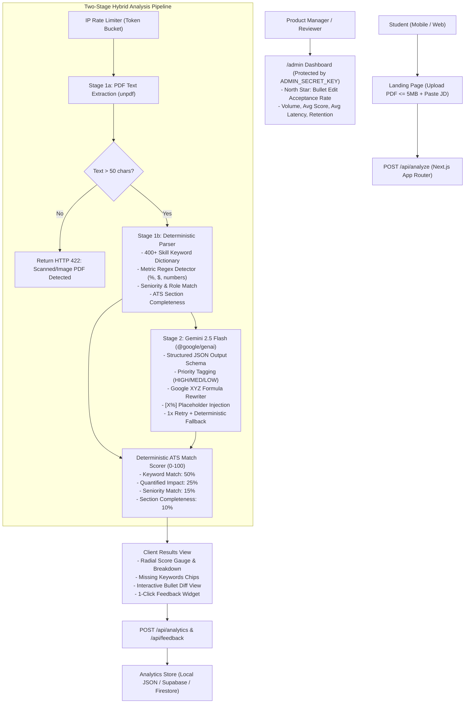

# ResumeGap — AI Resume & ATS Gap Copilot

> A 0-to-1 AI Resume & ATS Gap Copilot powered by the official **Google Gemini API** (`@google/genai`) and a deterministic audit engine. Engineered for graduating engineers applying off-campus.

---

## 🚀 Live Product Overview

**ResumeGap** helps engineering students bridge the gap between their resume and off-campus Job Descriptions (JDs) with sub-5s feedback, zero required sign-up, and zero resume data persistence.

- **Upload Resume (PDF)** + **Paste Target JD** (or 1-click test with pre-loaded SDE sample)
- **Transparent ATS Match Score (0–100)** computed via code-driven deterministic formulas (not subjective LLM outputs)
- **Missing Keywords Chips** categorized by priority (`HIGH`, `MEDIUM`, `LOW`) with contextual ATS impact
- **Google XYZ Bullet Rewriter**: Reframes weak bullets into *"Accomplished [X], as measured by [Y], by doing [Z]"* with zero hallucinated numbers (injects `[X%]` placeholders where metrics are missing)
- **Interactive Diff & Decision Cards**: Single-click *Accept*, *Reject*, or *Copy All Accepted*
- **Anonymous PM Analytics & Protected Admin Dashboard** (`/admin`) tracking adoption and the PM North Star: **Bullet Edit Acceptance Rate**.

---

## 🏛️ System Architecture



---

## 🧮 Transparent ATS Match Score Formula

Unlike tools that rely on arbitrary LLM scores, ResumeGap computes scores using strict, documented weights mirroring real enterprise applicant tracking systems (Taleo, Greenhouse, Workday):

$$\text{ATS Score} = (0.50 \times S_{\text{keywords}}) + (0.25 \times S_{\text{quantified}}) + (0.15 \times S_{\text{seniority}}) + (0.10 \times S_{\text{sections}})$$

| Pillar | Weight | Evaluation Method |
| :--- | :--- | :--- |
| **Keyword Match** | **50%** | Ratio of matched technical skills between JD and Resume across 400+ indexed CS/engineering terms |
| **Quantified Impact** | **25%** | Percentage of experience bullets containing verifiable metrics (`\d+%`, `\$?\d+`, `\d+x`, latency, user scale) |
| **Seniority Match** | **15%** | Alignment between JD target tier (Intern/Fresher/SDE 1 vs Senior) and candidate background |
| **Section Completeness** | **10%** | Structural validation for Experience, Education, Technical Skills, and Projects/Contact |

---

## ⚖️ Product Trade-Offs & Architectural Decisions

### 1. Latency vs. Accuracy
- **Trade-Off**: Real students on mobile drop off rapidly if analysis exceeds 8–10 seconds.
- **Solution**: We chose `gemini-2.5-flash` with low temperature (`0.2`) and strict JSON schemas combined with our Stage 1 in-memory regex detector. The complete deterministic audit runs in under **30ms**, and the total round-trip completes well within the **5-second target SLA**. A staged progress loader keeps perceived latency low.

### 2. Deterministic vs. LLM Scoring
- **Trade-Off**: LLMs are notorious for score drift (scoring the same resume 65/100 on one run and 85/100 on another).
- **Solution**: We completely decoupled scoring from the LLM. The ATS match score is calculated in pure TypeScript code. The LLM is used exclusively where it excels: semantic rewriting of bullet points into the Google XYZ formula and explaining why a missing keyword matters.

### 3. Hallucination Risk & Truthfulness
- **Trade-Off**: Language models often invent metrics (e.g., claiming a student "increased revenue by \$400K" when the student never mentioned numbers).
- **Solution**: We enforce a strict **Zero-Hallucination Guardrail**. Whenever an original bullet lacks hard metrics, Gemini must inject a conspicuous `[X%]` or `[Y users]` placeholder. The UI highlights this in amber, instructing students to fill in their real metrics before submitting off-campus applications.

---

## 🛠️ Tech Stack

- **Framework**: Next.js 16 (App Router, Turbopack, TypeScript)
- **Styling**: Tailwind CSS + Lucide Icons
- **AI SDK**: `@google/genai` (Official Google GenAI SDK)
- **Model**: `gemini-2.5-flash` (or custom via `GEMINI_MODEL`)
- **PDF Extraction**: `unpdf` (pure JS serverless-compatible PDF parser)
- **Analytics Store**: Dual-mode engine (local filesystem JSON persistence for zero-config local dev + pluggable cloud storage adapter)

---

## 📦 Setup & Local Development

### 1. Clone & Install
```bash
git clone <repo-url>
cd pm_project
npm install
```

### 2. Configure Environment Variables
Copy `.env.example` to `.env.local`:
```bash
cp .env.example .env.local
```

Edit `.env.local`:
```env
# Google Gemini API Key from https://aistudio.google.com/
GEMINI_API_KEY=your_gemini_api_key_here

# Model selection (defaults to gemini-2.5-flash)
GEMINI_MODEL=gemini-2.5-flash

# Secret key for accessing /admin metrics (Required: returns 503 if not set)
ADMIN_SECRET_KEY=your_secure_admin_secret_key

# Optional: Persistent Serverless Analytics on Vercel (Supabase)
SUPABASE_URL=
SUPABASE_SERVICE_ROLE_KEY=

# Optional: Distributed Serverless Rate Limiting on Vercel (Upstash Redis)
UPSTASH_REDIS_REST_URL=
UPSTASH_REDIS_REST_TOKEN=
```

> **Note**: If `GEMINI_API_KEY` is omitted, ResumeGap automatically activates its **Stage 1 Deterministic Fallback Generator** and displays a clear `Basic Analysis (AI Unavailable)` badge, allowing full local development and testing without credentials.

### 3. Run Locally
```bash
npm run dev
```
Open [http://localhost:3000](http://localhost:3000) in your browser.

---

## 🧪 Testing

Run the automated test suite:
```bash
# 1. Test Stage 1 Deterministic Engine (Keywords, Regex, Scoring)
npx tsx src/lib/__tests__/stage1-test.ts

# 2. Test Full End-to-End Live API, Multipart PDF Upload & Analytics Pipeline
npx tsx src/lib/__tests__/e2e-api-test.ts

# 3. Live Gemini Assertion Test (fails if fallback output is returned when key is set)
npx tsx src/lib/__tests__/gemini-live-e2e.test.ts

# 4. Mobile 390px Viewport Automation & Screenshot Capture
npx tsx scripts/mobile-test-390px.ts
```

---

## 📊 Product Analytics & PM Dashboard (`/admin`)

Visit [http://localhost:3000/admin](http://localhost:3000/admin) to inspect live product metrics:
- **PM North Star**: **Bullet Edit Acceptance Rate** ($\frac{\text{Accepted}}{\text{Accepted} + \text{Rejected}}$)
- Total Resumes Analyzed
- Average ATS Match Score & Latency (ms)
- User Feedback Positivity Rate (%)
- 7-Day Session Return Rate (%)
- Live anonymous activity stream and student feedback comments

---

## 🚀 Vercel Deployment

1. Push your repository to GitHub / GitLab.
2. Import the project into [Vercel](https://vercel.com/new).
3. Set the following environment variables in the Vercel Dashboard:
   - `GEMINI_API_KEY`: Your Google AI Studio API key
   - `GEMINI_MODEL`: `gemini-2.5-flash`
   - `ADMIN_SECRET_KEY`: A secure random password for your `/admin` route
4. Deploy! Next.js App Router route handlers run serverless on Vercel with zero extra server configuration.
